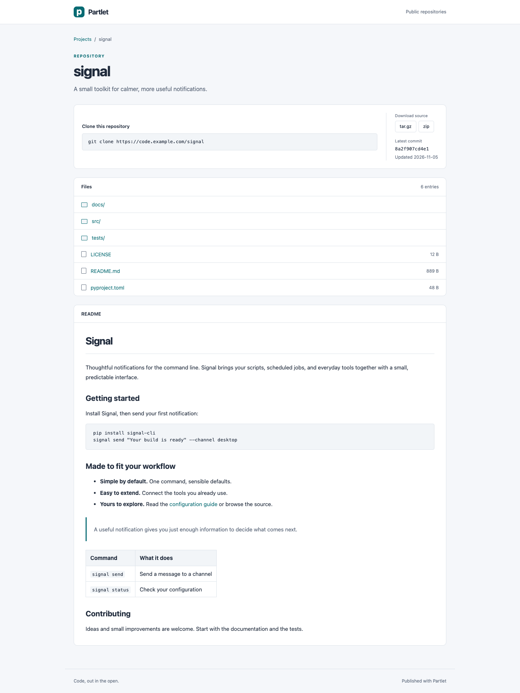
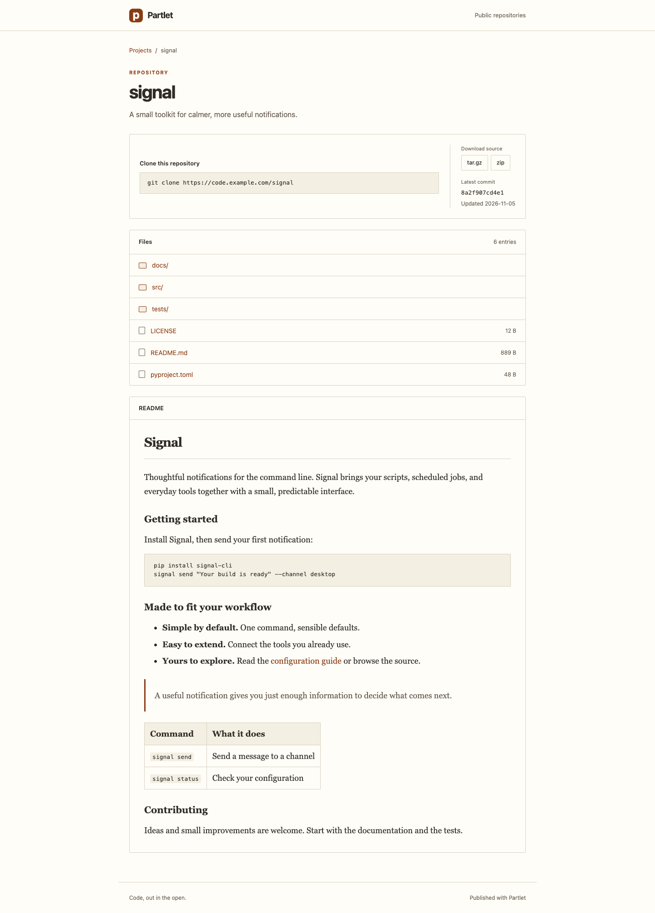
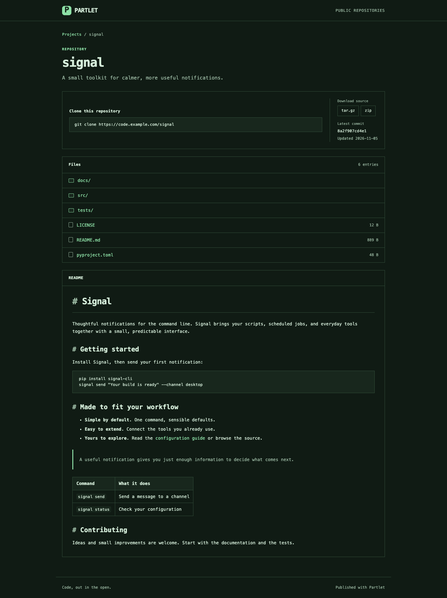

# Choose or install a site theme

Partlet themes change the appearance of your public site without
changing exported Git history. A theme applies to the project index,
file listings, README pages and highlighted source. Theme selection
lives in your source repository's `partlet.toml` and works in local
builds and the GitHub Action.

## Use the default layout

No theme configuration is required. With no `[site.theme]`, Partlet uses
Classic with automatic light and dark colors. It includes a project
directory, a framed file browser, clone and download actions, and
readable README pages. The layout adapts to narrow screens and uses
system fonts without JavaScript or external font downloads.

Existing sites receive the updated layout on their next successful
publication with the updated renderer revision. Exported Git history and
approval pins do not change. To see the default locally, leave the theme
table out of your manifest and run:

```bash
partlet preview --repo /path/to/source
```

## Choose a bundled theme

Add this table to your manifest:

```toml
[site.theme]
name = "paper"
mode = "auto"
```

| Name | Appearance |
| -- | -- |
| `classic` | The default repository browser with clean panels and a teal accent. |
| `paper` | More breathing room with serif README prose. |
| `terminal` | A monospace presentation with strong code emphasis. |

Classic, Paper and Terminal on the same synthetic project:







`mode` is `auto`, `light`, or `dark`. Auto follows the visitor's browser
color preference without JavaScript. There is no visitor toggle or
per-project theme. Discover the bundled choices with:

```bash
partlet theme list
partlet theme check --repo /path/to/source
```

Commit the manifest and push through your normal publishing workflow.
Theme-only changes rebuild pages even when project history is unchanged;
they do not require new history approval. An invalid theme stops the
operation before publication instead of silently falling back.

If you already run a public site, update its Worker to the matching
Partlet version **before publishing themed pages**: older Workers do not
serve the new theme resource URLs. Installing or selecting a theme does
not deploy your Worker. Follow the existing
[upgrade procedure](INSTALLATION.md#upgrades).

## Install a third-party theme

A theme is a directory of CSS and optional declared images. Review its
contents, license and origin before copying it into your source
repository. The [Copper example](../examples/themes/copper/theme.toml)
is a complete starting distribution. From a Partlet source checkout,
copy it into your own source repository:

```bash
SOURCE_REPO=/absolute/path/to/my-monorepo
mkdir -p "$SOURCE_REPO/themes"
cp -R examples/themes/copper "$SOURCE_REPO/themes/copper"
```

Select its directory instead of a bundled name:

```toml
[site.theme]
path = "themes/copper"
mode = "auto"
```

Use `name` or `path`, never both. A theme path is relative to the
manifest's directory and must stay inside the source repository. Use
forward slashes; absolute paths, traversal and symlinks are refused.

Commit the theme directory and manifest on `site.branch`, then validate:

```bash
partlet theme check --repo "$SOURCE_REPO"
```

Validation and local builds read the theme files from the committed
publishing branch, not your uncommitted CSS edits. Commit theme edits
before previewing them. Production publication additionally refuses
relevant checkout files that differ from that committed snapshot. No
theme packages, source-repository Python modules or build hooks execute.
No runtime theme download occurs. An updated theme takes effect when you
commit its contents and publish again.

For a local preview, follow the
[site preview instructions](../worker/README.md#preview-your-site).
Inspect both color modes, a narrow screen, README links, source line
numbers and keyboard focus before using a third-party theme publicly.

Only the stylesheet and explicitly declared images become public.
**These files are additional public content outside project exports.**
Exported-history secret scanning does not establish that theme assets
are safe to publish; inspect the files themselves. Theme CSS is trusted
presentation code: it can hide content or load external images under the
site's existing image policy. The restrictions on script execution are
preserved, but they do not make arbitrary CSS harmless.

Keep the distribution's license and record its source and immutable
revision alongside it. Installation requires no registry, marketplace,
subscription or automatic cloud provisioning.

## Write a theme

Use this distribution layout:

```text
my-theme/
  theme.toml
  style.css
  LICENSE
  assets/       # optional declared raster images
```

The root metadata table uses theme format version 2:

```toml
id = "my-theme"
name = "My theme"
version = "1.0.0"
format_version = 2
modes = ["auto", "light", "dark"]
license = "MIT"
assets = ["assets/pattern.png"]
```

Supply all three modes. `version` identifies your distribution release;
`format_version` identifies the Partlet compatibility contract. Unknown
formats and invalid metadata fail validation. Keep `LICENSE` locally; it
and `theme.toml` are not served as theme resources.

Only `style.css` and the listed assets are published. Assets must be
PNG, JPEG (`.jpg` or `.jpeg`), GIF or WebP with lowercase extensions.
Path segments begin with an ASCII letter, digit, underscore or hyphen
and otherwise contain only those characters and dots. Nested directories
inside `assets/` are allowed; empty segments and dot segments are not.
SVG, HTML, JavaScript and custom fonts are outside format version 2.
Reference declared images relative to `style.css`, for example
`url("assets/pattern.png")`; the published directory layout preserves
that relationship.

Format 2 refuses `@import`, `@font-face`, CSS backslash escapes and
undeclared local image references. Use `url()` for image references;
alternative image functions (`image-set()`, `-webkit-image-set()`,
`image()` and `src()`) are unsupported. Use literal Unicode text when
needed. Explicit HTTPS image URLs remain possible under the existing
image CSP; review them along with the rest of the stylesheet.

Partlet owns the HTML and escapes repository content. Themes use CSS;
they do not replace templates or provide executable plugins. The root
element exposes `data-theme` (the theme ID) and `data-mode` (`auto`,
`light`, or `dark`). Start with light defaults and cover explicit dark
mode and automatic dark preference:

```css
:root { --bg: #fffaf5; --fg: #30251f; }
:root[data-mode="dark"] { --bg: #211b17; --fg: #f7ebdf; }
@media (prefers-color-scheme: dark) {
  :root[data-mode="auto"] { --bg: #211b17; --fg: #f7ebdf; }
}
```

The complete [Copper stylesheet](../examples/themes/copper/style.css)
also overrides link, muted, code-background and focus colors. Set those
coherently; changing the page background alone can make text unreadable.

The stable format-2 tokens are:

| Purpose | Variables |
| -- | -- |
| Main colors | `--fg`, `--muted`, `--bg`, `--surface`, `--line`, `--link`, `--code-bg`, `--focus` |
| Fonts | `--body-font`, `--prose-font`, `--mono-font`, `--font-size`, `--line-height` |
| Layout | `--content-width`, `--space`, `--radius` |
| Code colors | `--syntax-comment`, `--syntax-keyword`, `--syntax-string`, `--syntax-number`, `--syntax-name`, `--syntax-error` |

`--surface` colors panels and the header. It defaults to `var(--bg)` so
panels follow the selected background colors.

Use system font stacks. Theme CSS follows Partlet's structural and code
styles so matching selectors override their defaults. Stable styling
hooks include `header.top`, `main`, `.crumbs`, `table.listing`,
`article.readme`, `.hl` and `.hl .linenos`. Preserve readable content,
visible keyboard focus, horizontal scrolling for code and usable narrow
screens. Check text and code colors against their actual backgrounds in
both light and dark modes. Breaking changes to these hooks require a new
theme format version.

## Publication and retained resources

Partlet fingerprints theme inputs and options and serves the resulting
CSS and images at immutable URLs. Resources upload before pages
reference them. Theme changes leave old resources available so cached
pages and projects skipped or failed during a later publication retain
their appearance. Old theme resources accumulate in storage; this
version does not automatically collect them. Reusing the same inputs
reuses the same resource namespace.

The default stylesheet route serves the same Classic layout for Worker
404 pages and rendering without an explicit theme. Removing a project
rebuilds the index using the stored site presentation; it does not
require the theme's local source directory or change the surviving
site's theme.

The renderer uses [version-1 page models](PAGE_MODELS.md) internally.
Output version 1 and theme format 2 are the supported combination.
Format-1 packs fail validation before any publication writes. There are
no compatibility adapters.

## Semantic output version 1

The root `html` exposes `data-partlet-page` (`index`, `tree`, `blob`)
and `data-partlet-output-version="1"`. `data-theme` selects the pack ID
and `data-mode` selects `auto`, `light`, or `dark`. These hooks, the
tokens above, and the semantic regions below form the supported
baseline. Incidental wrappers and whitespace are not a compatibility
contract.

| Region | Hook and value |
| -- | -- |
| Project row or project page main | `data-partlet-project`: public project name |
| Exported revision | `code[data-partlet-revision]`: complete opaque exported commit ID; visible text is abbreviated |
| Exported tip committer date | `time[datetime]`: exact ISO timestamp with timezone; visible date is YYYY-MM-DD |
| Entry row or blob content section | `data-partlet-entry-kind`: `directory`, `file`, or `symlink`; `data-partlet-path`: project-relative path |
| Blob size | `data[value]`: decimal byte count; visible text uses B, KiB, or MiB |
| README | `article.readme`: sanitized Markdown or escaped plaintext |
| Source | `.hl`: focusable scrolling region; `.linenos`: inline line numbers; `#L-N`: addressable source line N |

Directory sizes are absent; empty files have value `0`. Symlink sizes
count target bytes, never followed filesystem content. Dates describe
the exported tip, not publication time or individual file modification.
Nested directories and blobs expose the same project revision and date.
All values come from the [page models](PAGE_MODELS.md).

Navigation, clone instructions, archive and raw links, README content,
and source anchors work without CSS or JavaScript. Listings have named
tables and scoped column headings; kind labels remain visible without
CSS. Preserve these meanings when styling. Removing or changing a hook,
field meaning, or required value requires a new output version; breaking
the theme contract requires a new theme format. Optional additions with
explicit absence semantics can retain output version 1.

`RENDERER_REVISION` in `publish.py` participates in build identity and
must increase for rendering changes requiring regenerated pages, even
when the output contract stays compatible. Rebuilds keep exported commit
IDs and approval pins intact. Stored site presentation includes its
theme format and is validated before source-free index rebuilding or
removal. The existing read-only `/_partlet/index.json` project summary
remains available for publication diagnostics; it is not page-model
JSON.
